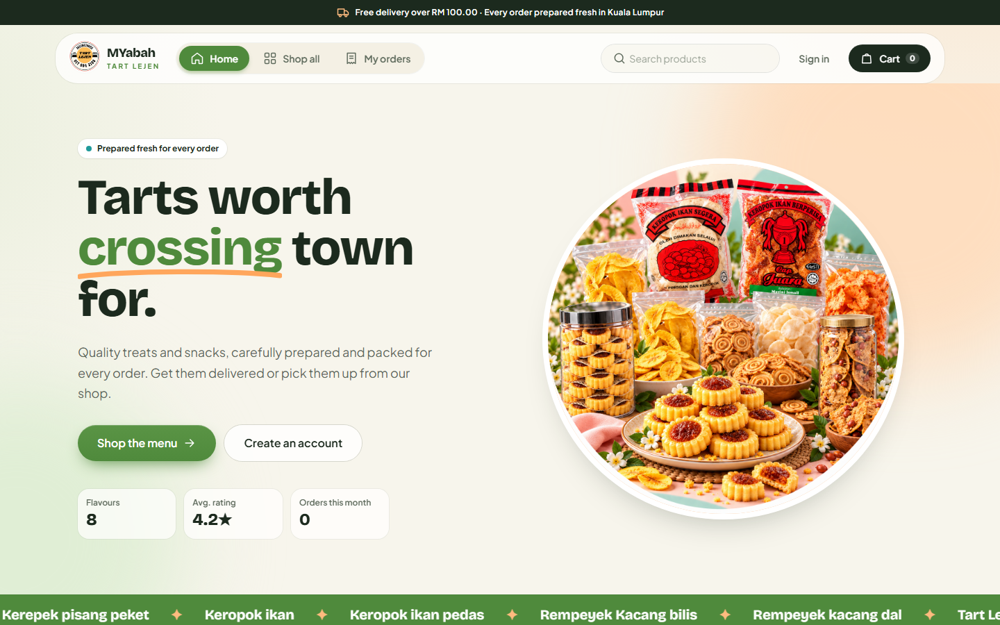
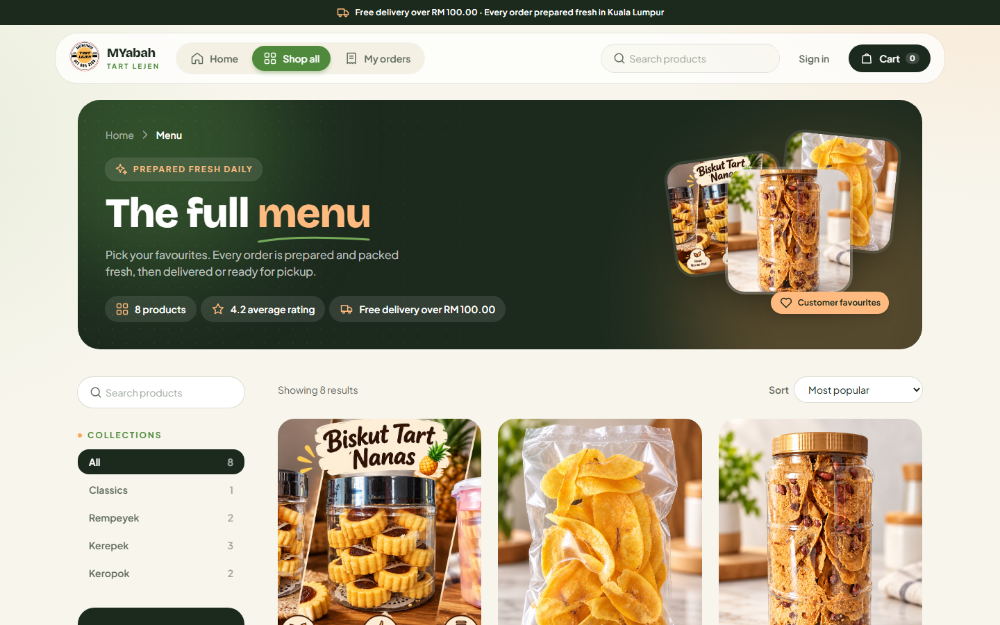
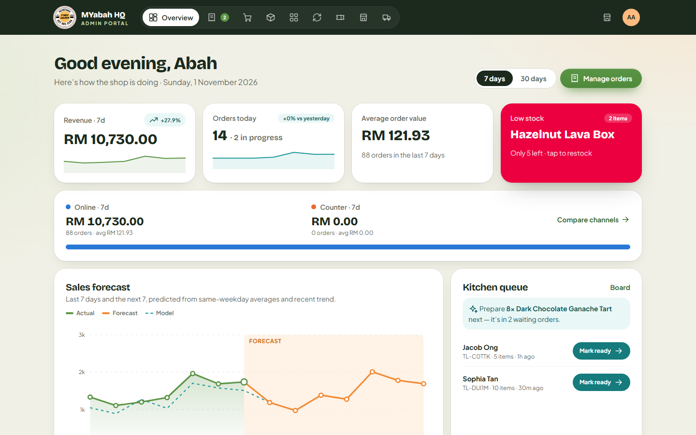
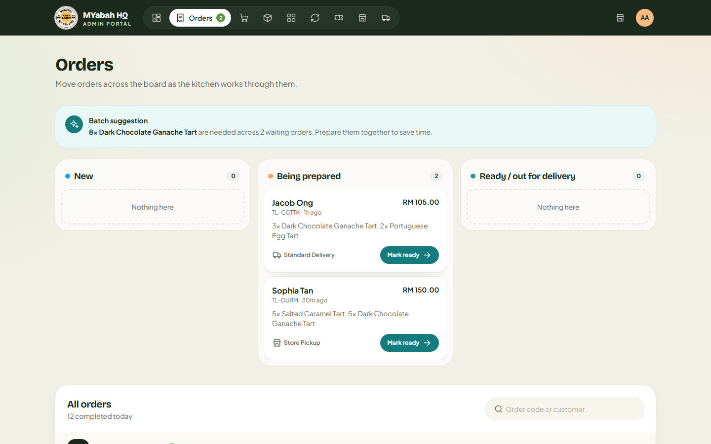
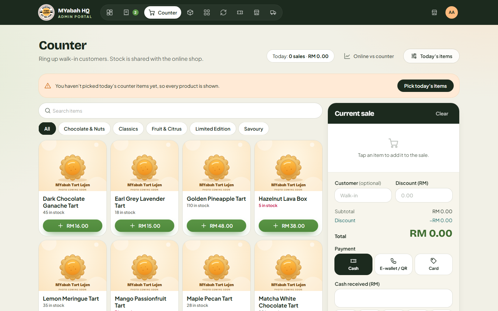
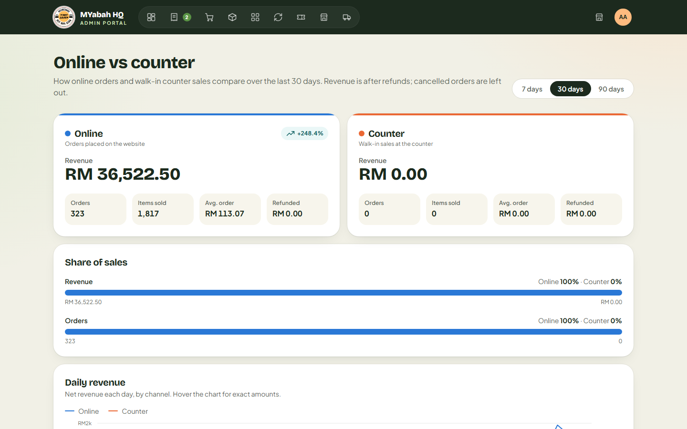
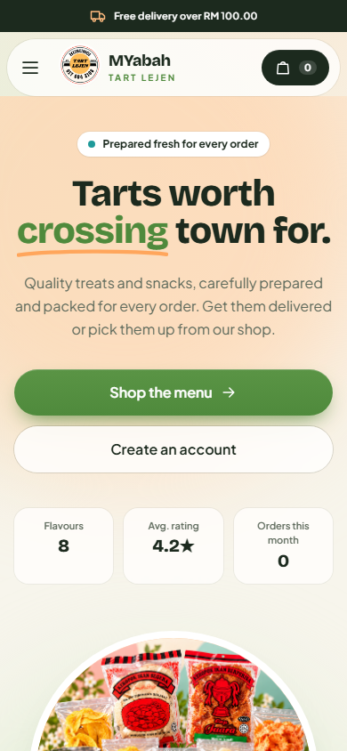
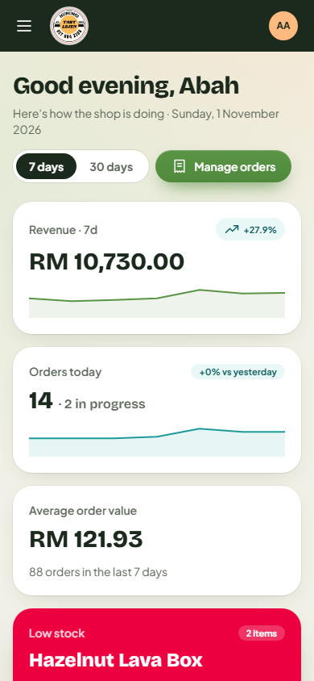

<p align="center">
  
</p>

# MYabah Tart Lejen

An online shop and point-of-sale system for a tart bakery, built with Laravel 13. Customers browse the menu, order for delivery or pickup and pay online. The shop team runs orders, stock, the counter (POS), refunds and vouchers from an admin panel, and a JSON API lets an admin mobile app do the same.



## Screenshots

Admin screenshots use the fictional orders and customers from `php artisan db:seed`.

| Menu | Admin dashboard |
| --- | --- |
|  |  |

| Order board | Point of sale |
| --- | --- |
|  |  |

| Online vs counter sales | Works on phones |
| --- | --- |
|  |   |

## Features

**Storefront (customers)**
- Menu with collections, product sizes, photos and reviews
- Cart, vouchers and live delivery quotes from Lalamove
- Checkout with standard, express or pickup delivery
- Online payment through Billplz. Orders left unpaid for 30 minutes are cancelled automatically.
- Accounts with email verification, password reset and a profile page
- Order history with cancel, reorder and refund requests
- Live order status updates

**Admin panel (`/admin`)**
- Dashboard with shop insights
- Order management (received → preparing → ready → completed / cancelled)
- Products, stock and restocking, collections
- Point of sale for counter sales with receipts and a configurable counter menu
- Sales report split by online and counter channels
- Refunds, vouchers, review moderation
- Delivery settings and storefront customisation, including colour themes

**Admin mobile API (`/api/admin`)**
- Token login for administrators only
- Read endpoints that return the same data as the admin panel pages
- Write endpoints that go through the admin panel's own controllers, so the app follows the same rules

## Tech stack

- PHP 8.3, Laravel 13
- Blade, Tailwind CSS 4, Vite
- SQLite by default; MySQL works too
- Billplz (payments), Lalamove (delivery)
- PHPUnit, Laravel Pint

## Getting started

Requirements: PHP 8.3+, Composer, Node.js and npm.

```bash
git clone <repo-url> MyAbahTartLejen
cd MyAbahTartLejen
composer run setup
```

`composer run setup` installs dependencies, creates `.env`, generates the app key, runs the migrations and builds the frontend assets.

Load the demo catalogue, orders and accounts:

```bash
php artisan db:seed
```

The seeded admin account is defined in [database/seeders/ShopDemoSeeder.php](database/seeders/ShopDemoSeeder.php). Change its password before using it anywhere public.

Start the development processes (web server, Vite and friends):

```bash
composer run dev
```

Then open http://localhost:8000. If you use Laragon, the site is also served at `http://myabahtartlejen.test`.

### Scheduler

Unpaid online orders are cancelled by the `orders:cancel-unpaid` command, which runs every five minutes. Keep the scheduler running locally:

```bash
php artisan schedule:work
```

In production, add the usual cron entry:

```
* * * * * cd /path/to/app && php artisan schedule:run >> /dev/null 2>&1
```

## Configuration

Set these in `.env`:

| Variable | Purpose |
| --- | --- |
| `APP_TIMEZONE` | Defaults to `Asia/Kuala_Lumpur` |
| `BILLPLZ_API_KEY`, `BILLPLZ_COLLECTION_ID`, `BILLPLZ_X_SIGNATURE` | Billplz online payments |
| `BILLPLZ_SANDBOX` | `true` to use the Billplz sandbox |
| `LALAMOVE_API_KEY`, `LALAMOVE_API_SECRET` | Lalamove delivery quotes |
| `LALAMOVE_SANDBOX`, `LALAMOVE_MARKET` | Lalamove environment and market (default `MY`) |
| `MAIL_*` | Mail for email verification and password resets (default: `log`) |
| `PUBLIC_UPLOADS_IN_PUBLIC` | `true` on hosts without symlink support (e.g. InfinityFree) to save uploads straight into `public/storage` |

Otherwise, run `php artisan storage:link` so uploaded product photos are publicly reachable.

Billplz needs to reach `POST /payments/billplz/callback`, so use a public URL (or a tunnel) when testing payments locally.

## Admin mobile API

All endpoints live under `/api/admin` and always respond with JSON.

Sign in to get a token:

```http
POST /api/admin/login
Content-Type: application/json

{ "email": "admin@example.com", "password": "secret", "device_name": "My phone" }
```

Send the token with every other request:

```http
Authorization: Bearer <token>
```

| Area | Endpoints |
| --- | --- |
| Account | `GET /me`, `POST /logout`, `GET /options` |
| Dashboard | `GET /dashboard` |
| Orders | `GET /orders`, `GET /orders/{order}`, `PATCH /orders/{order}/status` |
| Products | `GET/POST /products`, `GET/POST/DELETE /products/{product}`, `PATCH /products/{product}/stock`, `POST /products/{product}/restock` |
| Collections | `GET/POST /collections`, `POST/DELETE /collections/{category}` |
| Sales | `GET /sales` |
| Storefront | `GET/POST /storefront`, `DELETE /reviews/{review}` |
| Delivery | `GET/PUT /delivery` |
| POS | `GET /pos`, `POST /pos/sales`, `GET /pos/sales/{order}`, `GET/PUT /pos/menu` |
| Refunds | `GET /refunds`, `POST /orders/{order}/refunds`, `PATCH /refunds/{refund}` |
| Vouchers | `GET/POST /vouchers`, `PATCH/DELETE /vouchers/{voucher}` |

Product and collection updates use `POST` instead of `PUT` so photos can be sent as multipart form data. Run `php artisan route:list --path=api` for the full list.

## Testing

```bash
composer run test
```

Or run a single file:

```bash
php artisan test --compact tests/Feature/AdminApiTest.php
```

Format PHP code with Pint before committing:

```bash
vendor/bin/pint --dirty
```

## Project structure

```
app/
├── Console/Commands/      # orders:cancel-unpaid
├── Enums/                 # Order status, payment, delivery, refund, theme…
├── Http/Controllers/
│   ├── Admin/             # Admin panel
│   ├── Api/               # Admin mobile API
│   └── Auth/              # Login, register, password reset, email verification
├── Http/Resources/        # API resources
├── Models/
└── Services/              # Billplz, Lalamove, Cart, Storefront, ShopInsights…
database/seeders/          # Catalogue and demo data
resources/views/           # Blade views
routes/                    # web.php, api.php, console.php
tests/Feature/
```

## License

MIT
